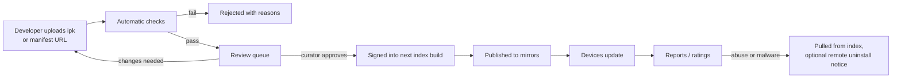

# App store: web apps, legacy apps and the catalog

> **Decisions (28 September 2026, from the project owner).** The web is the
> platform, so the catalog leads with **a curated list of popular websites
> that already ship a PWA**, each presented as an app you install from the
> catalog, instead of the usual "visit the site and add it to the home
> screen" (which still works). Next to it: an **Android catalog** (see
> [ANDROID.md](ANDROID.md)), and the **App Museum / Preware archives as
> add-on catalogs** a user can switch on.
>
> **1 October 2026:** it is called the **Marketplace** for now; Phoenix
> picks the curated sites and they can opt out; the App Museum is used and
> the owner is telling the webOS Archive (it is removed if they say no); the
> PHP backend runs on this computer until launch, then on a server.
>
> **Status:** A0 (the Marketplace app and its service), A2 (App Museum II
> and Preware feeds as add-on catalogs) and A3 (the catalog service,
> `server/marketplace`) are done in the simulator; see
> [APP-RUNTIME.md](APP-RUNTIME.md#marketplace). Still to do: the server
> online, A1 and A4 on a device, the Android catalog.
>
> **Running the catalog (9 October 2026).** Until the server is online the
> catalog runs on the developer's computer, and the simulator starts it:
> **Services > Marketplace Catalog** in its menu bar (it shows the service
> starting, running at 127.0.0.1:8088, or failed with the reason and its
> log, and opens the Marketplace once it answers), **Start Local Catalog**
> on the Marketplace's "Can't reach" card (simulator only, through the
> runtime's `org.webosphoenix.simulator`; a device never shows it),
> `./phoenix run --marketplace`, or **Services > Start Catalog with the
> Simulator** for every run. `./phoenix` installs PHP 8 for it.
> `server/marketplace/README.md` has the details.
>
> **Curated web apps (8 October 2026; 9 October: 135, as a site whose
> manifest is good but whose icons are all broken is listed with an icon the
> catalog generates, its initials on its theme colour; 15 October: 140, with
> Slack):** 140 of 168 sites in 23 categories
> (`server/marketplace/catalog/curated-sites.json`; `bin/probe-pwas.py`
> checks each manifest live and leaves out the ones it cannot find, with the
> reason, in `curated-pwas.json`): social networks and messaging, Google's and
> Microsoft's apps, Proton's, task and note apps, streaming video and music,
> news, maps, shopping, finance, learning, developer tools, games, weather,
> sports and fitness, AI assistants (ChatGPT, Claude). Sites without a
> usable manifest are not listed, unless Phoenix writes one for a site that
> publishes none, as browser extensions do for Slack (the owner, 15 October
> 2026: "Our catalog doesn't have the Slack web PWA app listed. That most
> definitely needs to have it listed"; [1.2](#12-from-manifest-to-webos-app),
> "A site with no manifest"); many of the rest turned the probe away
> with a bot check from the cloud network it ran on, so the owner refreshes
> the list from a home connection (`server/marketplace/README.md`,
> "Refreshing the list"), and `seed` then `publish` put it in the catalog.
>
> **Open-source web apps and the 2.0 apps (13 October 2026, the owner):**
> "all of these apps in the catalog for installation [ArtCraft's] ... a list
> of all major web built popular apps from linux ... in our app feed in the
> marketplace. we will also host all the updated versions of 2.0 apps there
> in case someone wants to redownload or add them to 1.0." Done in the
> simulator: twelve open-source web apps hosted from their upstreams'
> releases (the ten ArtCraft apps, KeeWeb, Phanpy), four more linked as
> curated web apps, the rest of the list decided with reasons
> ([WEB-APP-CATALOG.md](WEB-APP-CATALOG.md); [3.12](#312-open-source-web-apps));
> the 41 apps of webOS Phoenix 2.0 published from a phoenix-default-apps
> checkout ([3.13](#313-the-20-apps)); and a catalog app with a built-in
> app's id installs as an update in its place, removable back to the
> built-in version, as webOS did ([3.14](#314-updating-a-built-in-app)).
>
> **One local catalog, and feeds by device and kind (14 October 2026, the
> owner):** "build the shared local catalog ... make the feeds more dynamic,
> so we can specify mobile, tablet, desktop, legacy, phoenix, native, local,
> web app, etc, so we can turn off and on certain apps for specific
> devices." Done in the simulator: one catalog per user for every simulator
> of every checkout, running while any of them runs and filling itself
> ([3.16](#316-one-local-catalog-for-every-simulator)); device classes and
> kinds of app, switched by the catalog's admin per class and by the user
> per device ([3.17](#317-device-classes-kinds-and-feeds)). Not run on a
> Mac or a device yet.

How people will find, install and update apps on Phoenix: installable web
apps (PWAs) as first-class cards, the original webOS `.ipk` apps from the
community archives, and a catalog app with a backend behind it.

This is a plan. Nothing here has run on a device yet (see
[ROADMAP.md](ROADMAP.md), Milestone 1). Facts are as of **28 September
2026**. Where we read source code rather than documentation, it says so;
where something is unverified, it says that too. The row in
[APP-GAPS.md](APP-GAPS.md#store-setup-backup-and-updates) that asks for "one
catalog app with three sources" is the starting point.

## Summary

- **One catalog app, three kinds of app.** Phoenix web apps and other
  packaged `.ipk` apps; installable web apps (PWAs) from any HTTPS site;
  legacy Mojo and Enyo apps from the webOS Archive's App Museum II.
- **PWAs become real webOS apps.** For each installed PWA the device writes
  an `appinfo.json` and icons and installs them through OSE's own installer,
  which has had a path for exactly this since OSE 2.26. The PWA then has its
  own launcher icon, its own cards, its own notifications and its own
  Just Type entries, like any other app.
- **The device reads a static, signed catalog.** A JSON index signed with
  an Ed25519 key, served from any web host or mirror. Installing and
  updating never depend on a live API.
- **A small PHP + MySQL service writes that index.** Developer accounts,
  submissions, review, ratings and moderation live in a LAMP app that
  publishes the static index. This fits the stack you prefer and is the
  same shape as the App Museum's own backend (PHP, MySQL), which is the
  obvious partner.
- **Payments are deferred.** Listings can carry donation links; nothing is
  sold through the store in the first year.
- **Web apps only at first.** Packages that contain native code or
  background services wait until there is a sandbox for them (phase A5).
  Until then, Developer Mode (Settings, behind the device PIN or password)
  lets a user install packages with install scripts or services (not
  native code) from Preware feeds and other catalogs
  themselves, unsandboxed and at their own risk
  ([APP-RUNTIME.md](APP-RUNTIME.md#developer-mode)).
- **Synergy connectors** (account types with a background service,
  [SYNERGY-CONNECTORS.md](SYNERGY-CONNECTORS.md)) are the one kind of
  package with a service the catalog takes (phase C4): checked against the
  connector rules, listed as kind `connector`, their account types in the
  Marketplace's Connections. A device installs a third-party one in
  Developer Mode only until the connector tier (C5); the ones Phoenix comes
  with (the Fediverse) are pre-installed, removable and installed again from
  the catalog without it. The path, from `phoenix-connector publish` to the
  device: `server/marketplace/README.md` "Connector packages",
  [SYNERGY-SDK.md](SYNERGY-SDK.md) "Publishing" and "Testing in the
  simulator".

## Contents

1. [PWAs as webOS apps](#1-pwas-as-webos-apps)
2. [Legacy webOS apps](#2-legacy-webos-apps)
3. [The store](#3-the-store)
   - [3.11 Streaming apps and DRM](#311-streaming-apps-and-drm)
   - [3.12 Open-source web apps](#312-open-source-web-apps)
   - [3.13 The 2.0 apps](#313-the-20-apps)
   - [3.14 Updating a built-in app](#314-updating-a-built-in-app)
   - [3.15 Update logs](#315-update-logs)
   - [3.16 One local catalog for every simulator](#316-one-local-catalog-for-every-simulator)
   - [3.17 Device classes, kinds and feeds](#317-device-classes-kinds-and-feeds)
4. [Roadmap](#4-roadmap)
5. [Risks](#5-risks)
6. [Open questions](#6-open-questions)
7. [Sources](#7-sources)

---

## 1. PWAs as webOS apps

### 1.1 What OSE already does

OSE's installer daemon, **appinstalld2** (`com.webos.appInstallService`),
gained "Progressive Web App installation" in OSE 2.26.0 (June 2024,
[release notes](https://www.webosose.org/about/release-notes/webos-ose-2-26-0-release-notes/)).
The release notes say nothing more, so we read the source
([webosose/appinstalld2](https://github.com/webosose/appinstalld2), last
commit 21 January 2025):

- `install {id, ipkUrl}` accepts `ipkUrl: "pwa://<directory>"` as well as a
  path to an `.ipk` (`src/base/Utils.cpp`, `isPWA`, `getPWAPath`).
- For a `pwa://` URL it runs `UnpackagedInstallStep` instead of opkg: it
  checks that `<directory>/appinfo.json` parses and that its `id` matches,
  makes `/media/cryptofs/apps/usr/palm/applications/<id>/`, and copies
  `appinfo.json` and every `icon*` file into it. Nothing else is copied.
- So OSE does **not** fetch a manifest, download icons or cache pages. Some
  other component is expected to prepare that directory. We found no such
  component in OSE's public repositories (*unverified*: OSE's browser may
  do it in a version we did not find). **Phoenix writes it.**
- `install`, `remove` and `status` are in the ACG group
  `applicationinstall.management`, granted to the `oem` trust level only
  (`files/sysbus/appinstalld.groups.json`). The store therefore needs a
  small trusted service; an ordinary app cannot install anything.
- There is **no signature check** anywhere in appinstalld2. Its `verify`
  flag only chooses the install root (`/media/cryptofs` or
  `/media/developer`). Trust has to be enforced before the call (see
  [3.6](#36-security)).

### 1.2 From manifest to webOS app

```
 web page ── <link rel=manifest> ──┐
                                   ▼
 ┌──────────────────────── org.webosphoenix.service.packages ─────────────────────┐
 │ 1 fetch manifest (HTTPS only), resolve against the page URL                   │
 │ 2 check it: name, start_url and scope on the same origin, at least one icon   │
 │ 3 pick an app id: org.webosphoenix.pwa.<hash of manifest id>                  │
 │ 4 download icons, render the launcher sizes (1.3), write appinfo.json         │
 │ 5 write a launch stub index.html (1.4) - kept in the app's data, see below    │
 │ 6 luna://com.webos.appInstallService/install {id, ipkUrl: "pwa://<dir>"}      │
 │ 7 record origin, manifest URL, manifest hash, install source in db8           │
 └───────────────────────────────────────────────────────────────────────────────┘
                                   ▼
 SAM sees a new app ── launcher icon (Downloads tab), Just Type, cards
```

The service is Node.js on `run-js-service`, like the Files and Voice Memos
services already in `apps/`. The manifest parsing and `appinfo.json`
generation are a TypeScript library shared by the service, the catalog
backend's validator and the tests.

**Mapping the manifest to `appinfo.json`:**

| Web app manifest | `appinfo.json` | Notes |
| --- | --- | --- |
| `id` (or `start_url` when absent) | `id` = `org.webosphoenix.pwa.` + first 16 hex digits of SHA-256 of the resolved manifest id | Stable across updates, as the manifest spec intends. The origin is kept in `phoenix.pwa.origin` |
| `name` | `title` | |
| `short_name` | launcher label (`phoenix.launcherTitle`) | Legacy launcher labels were short |
| `icons` | `icon`, `largeIcon`, `phoenix.icons` | See [1.3](#13-icons-at-every-density) |
| `start_url` | `phoenix.pwa.startUrl`; `main` is the stub | See [1.4](#14-which-web-runtime) |
| `scope` | `phoenix.pwa.scope` | Navigations outside the scope open in the browser card, as installed PWAs do on Android |
| `display` | `phoenix.pwa.display` | `fullscreen` hides the status bar; the rest look the same in a card |
| `orientation` | the runtime's orientation lock | Same mechanism Phoenix apps use (`setWindowOrientation`) |
| `theme_color`, `background_color` | `iconColor`, `splashColor` | The launch card's colour while loading |
| `description`, `categories` | catalog listing and Just Type keywords | |
| `shortcuts` | `universalSearch.action` entries and app menu items | See [1.5](#15-the-rest-of-the-webos-experience) |
| `share_target` | `phoenix.shareTarget` | Phoenix's share sheet lists it |
| `file_handlers` | `phoenix.fileHandlers` (MIME types and extensions) | Files' "Open with" (`listAllHandlersForMime`) lists it |
| `protocol_handlers` | `phoenix.protocolHandlers` | Only `web+` schemes and the safelist Chromium allows |
| `launch_handler` | ignored at first | Phoenix focuses the existing card, which is `focus-existing` |
| (none) | `type: "web"`, `vendor` = origin host, `version` = `0.0.<manifest hash prefix as a number>` | The version changes whenever the manifest does, so the installer treats a re-install as an update |
| (none) | `requiredPermissions: ["org.webosphoenix.pwa"]` | One narrow ACG; see [3.6](#36-security) |

`appinfo.json` keys that OSE does not know are ignored by SAM (the Phoenix
apps already carry a `phoenix` block this way).

**A site with no manifest (15 October 2026).** Slack's web client
(`https://app.slack.com/client`, which answers with the real client)
publishes no web app manifest: its pages link none, `/manifest.json`,
`/manifest.webmanifest` and `/site.webmanifest` answer 404, and browser
extensions ("Slack PWA", "Better PWAs") make it installable by adding one.
The catalog does the same. A curated site's entry in `curated-sites.json`
may carry `webManifest`, the manifest Phoenix writes for it: the site's
name, its start page and scope on the site, `display: standalone`, and as
icons the pictures the site itself publishes for browsers and home screens,
at their addresses there (Slack's links only a 32 px favicon; its
`/favicon.ico`, whose biggest picture is a 256 px PNG, and its
`/apple-touch-icon-precomposed.png`, 57 px, are the conventional addresses
browsers ask for, and both redirect to its own CDN). `bin/probe-pwas.py`
uses it only when the site has no manifest of its own (and says when it
gets one), checks it as it checks a site's own, and marks it
`"manifestBy": "phoenix"`; `seed` publishes it with the catalog,
`/v1/manifests/<id>-<hash>.webmanifest`, named by its contents, and the
signed index gives its SHA-256, `"pwa": {manifest, origin, sha256}`. The
device fetches it as it fetches any manifest, takes it only when it
matches that SHA-256 (from the catalog or any mirror), and starts the app
only on the site the index names: the W3C rule that ignores a start URL on
another origin is applied against that site (`parseManifest`'s page URL,
`entry.pwa.origin`), not against the manifest's own host, as for a site's
manifest kept on a CDN (Spotify's), so a manifest on the catalog's host
gains no other site. The id stays the catalog's (`org.webosphoenix.pwa.slack`).
Nothing of Slack's is copied into the repository: the icons are fetched
from Slack when the app is installed, and the listing's from the catalog's
copy, as for every curated web app. Checked in the simulator the same day:
Slack is listed, installs with its icon and opens in its own card, where
Slack answers "Please update your browser or use the Slack app". It serves
its client only to Chrome 137 or newer, by the user agent (the same request
naming Chrome/136 is refused with 403, Chrome/137 is served), and Phoenix's
web runtime names its own Chromium: 122 in the simulator (Qt 6.8), 120 in
OSE's WAM. Using Slack on Phoenix needs a newer engine or a user agent that
names a current Chrome for such sites (open).

### 1.3 Icons at every density

Legacy webOS drew launcher icons at 64 legacy pixels
(`Theme.launcherIconSize`, `images/launcher3/launcher-icon-64.png`), quick
launch icons at 48 on phones and 64 on tablets, and the launch splash at
128 (192 on tablets). `Theme.px()` scales them from 1.0 (Pre) to about 3.4
(a 1080-pixel-wide phone). The service renders, from the largest suitable
manifest icon:

| File | Size (px) | Used for |
| --- | --- | --- |
| `icon.png` | 64 | Legacy-pixel icon, the size OSE's own launcher expects in `icon` |
| `icon-96.png`, `icon-128.png`, `icon-160.png`, `icon-256.png` | 96, 128, 160, 256 | Pre 3 (1.5x), 2x, 2.5x, and 3.4x screens (downscaled at draw time) |
| `largeIcon.png` | 256 | `largeIcon` |
| `icon-splash.png` | 384 | The launch card (192 legacy px at 2x) |

Rules: prefer an icon with `purpose: "any"`; if only `maskable` exists,
crop to its safe zone (the inner 80%) and put it on a rounded webOS icon
plate; draw a letter icon on `theme_color` if no icon can be fetched.
Classic webOS icons were free-form shapes with a drop shadow, not squircles,
so `any` icons are drawn as they are with the legacy shadow; but one that
fills its whole square (opaque corners: Lichess's) sits on a rounded plate a
little inside its tile (`AppIcon.qml`, 56 of 64 px with 8 px corners and a
dark edge), the frame Phoenix gives a page added to the launcher, as the
Marketplace rounds it. SVG icons are
rasterised with `resvg` (MPL-2.0, run as a program) or Chromium itself.
A `favicon.ico` becomes the PNG its biggest picture is (`lib/pwa.js`
`icoPng`): Qt's ICO reader gives a file's first picture, and Slack's starts
with its 16 px one; an ICO whose biggest picture is a bitmap stays as it is.
appinstalld2 copies only files named `icon*`, so every picture the app
needs must be named that way.

### 1.4 Which web runtime

| Option | What it means | Verdict |
| --- | --- | --- |
| **OSE's WebAppMgr (WAM) on Chromium 120** | The PWA is an ordinary `type: web` app; WAM makes the window, the shell makes the card | **Use this.** One engine, one GPU process, one memory budget; the same path every Phoenix app takes |
| OSE's browser (Enact browser) in an app window | Open the site in a browser tab without browser chrome | No per-app identity: one app, one card stack, one set of notifications for every PWA |
| A separate Chromium or Firefox build | A full browser with its own PWA support | Hundreds of MB more, a second GPU stack, and its PWA install targets desktops, not webOS |
| `phoenix-runtime.js` | The PalmSystem shim | Not a runtime: it runs inside WAM and the simulator. PWAs get none of it except the small PWA shim below |

How the page gets loaded: `main` is a local `index.html` stub that
navigates to `start_url` (`location.replace`). Whether WAM also accepts an
absolute `https://` URL in `main` is *unverified*; OSE's
[appinfo.json documentation](https://www.webosose.org/docs/guides/development/configuration-files/appinfo-json/)
only describes local files. The stub works either way, and appinstalld2's
`pwa://` step only copies `appinfo.json` and `icon*`, so the stub has to be
provided another way: either the `pwa://` install is followed by a write
of the stub into the app directory by the (oem) service, or every PWA
points `main` at one shared stub in `/usr/share/phoenix/pwa/launch.html`
that reads the target from its launch parameters (*decide in A1*).

What a web app gets from WAM and what Phoenix has to add. Chromium splits
PWA support in two: the engine parts (service workers, Cache Storage,
IndexedDB, Notifications from pages) live in Blink and `content/`, which
WAM embeds; the "installed app" parts (install prompts, manifest
application, share target, file handling, badging on an OS icon,
web-app shortcuts) live in Chrome's `chrome/browser/web_applications`
layer, which an embedder like WAM does not include. This is our reading of
how Chromium is layered, *to be confirmed on the device in A1*.

| Feature | In WAM (Chromium 120) | Phoenix work |
| --- | --- | --- |
| Service worker, Cache Storage, offline | Engine feature; needs a secure origin, which a real `https://` PWA has. Packaged `file://` apps cannot use it | Check that WAM enables it for `type: web` apps (*unverified*) |
| IndexedDB, localStorage, OPFS | Yes, per origin | Per-app "Clear data" = clear that origin |
| `beforeinstallprompt` / install from the browser | Chrome layer: not in WAM | The browser card offers "Add to Launcher" when the page has a manifest (Isis browser menu, later the modern browser) |
| `Notification` from a page | The embedder must supply a platform notification service (*unverified whether Neva/WAM routes it anywhere*) | Route to `com.webos.notification` with the app id as source; see [1.5](#15-the-rest-of-the-webos-experience) |
| `showNotification` from a service worker | Same service, with the page possibly closed | Same bridge; tapping launches the app with the notification's data |
| Push API | Needs a push service. Chrome uses Google's FCM, which needs Google API keys; builds without them cannot subscribe ([ungoogled-chromium #1020](https://github.com/ungoogled-software/ungoogled-chromium/issues/1020)) | Phase A4: an RFC 8030 Web Push server (Mozilla's autopush, or a UnifiedPush distributor) and a push daemon that wakes WAM. Until then, `PushManager.subscribe` fails and apps fall back as they do in Firefox private mode |
| Badging (`navigator.setAppBadge`) | Chrome layer | Small shim → a count on the launcher icon and the card title |
| Web Share (`navigator.share`) | Shipped on ChromeOS, Windows and macOS; on Linux desktop *unverified* | Shim → Phoenix share sheet (the one Photos and Voice Memos use) |
| Web Share Target | Chrome layer; Android, ChromeOS and Windows ([Chrome docs](https://developer.chrome.com/docs/capabilities/web-apis/web-share-target)) | The share sheet lists `phoenix.shareTarget` apps and launches them with the form data (GET), or a local page that POSTs it (POST) |
| File Handling | Chrome layer | Files' "Open with" launches the app; the runtime fills `window.launchQueue` |
| Geolocation, camera, microphone | Engine; the embedder decides permission | Prompt in the shell (see [3.6](#36-security)); OSE's static `allowVideoCapture` / `allowAudioCapture` are set to true for PWAs and the prompt decides |
| Storage quota | Chromium's shared pool, best effort, evicted under pressure unless `navigator.storage.persist()` is granted | Grant `persist()` to installed PWAs automatically, as Chrome does for installed apps; show usage in App info |
| Periodic Background Sync, Background Fetch | Chrome layer / needs embedder | Not in the first phases |

The **PWA shim** is a few hundred lines injected into PWA windows only
(`phoenix-pwa-shim.js`, the way `phoenix-runtime.js` is injected into
webOS apps): badging, `navigator.share`, `launchQueue`, the app menu hook
and the back gesture. It does **not** expose `PalmServiceBridge` or any
Luna service to the page.

### 1.5 The rest of the webOS experience

| webOS feature | For a PWA |
| --- | --- |
| **Launcher** | The icon appears in the **Downloads** tab (`launcherTab: 1`), where legacy webOS put installed apps; the user can move it to the dock like any icon |
| **Cards** | One card per window. `window.open()` and links with `target=_blank` inside the scope make a new card in the app's stack, as enyo windows do today; outside the scope they go to the browser |
| **Back gesture** | `history.back()` when the page has history; otherwise minimise the card (legacy behaviour at the top of an app) |
| **App menu** (tap the app name) | Reload, Share page, Open in browser, App info (origin, storage, permissions), Uninstall; manifest `shortcuts` listed above them |
| **Just Type** | Title, `short_name` and `categories` as keywords; each manifest shortcut becomes a Just Type action ("New note in Notes") through `universalSearch.action`. Searching inside the app is not possible without an API; leave it out |
| **Notifications** | Banner and dashboard item attributed to the app's id, with its icon; tapping focuses or launches the app and passes the notification's `data` |
| **Badges** | A count on the launcher icon and the card title |
| **Sharing** | The Phoenix share sheet offers PWAs with a share target |
| **Files** | "Open with" offers PWAs with file handlers |
| **Updates** | The site updates its own code through the service worker. The service re-reads the manifest when the app is launched and at most once a day (Chrome does the same); a new name or icon is a re-install with the same id. A changed origin is a different app |
| **Uninstall** | `com.webos.appInstallService/remove`, then clear the origin's data (asking first) |

---

## 2. Legacy webOS apps

### 2.1 What exists (September 2026)

| Source | What it is | State | Licence / terms |
| --- | --- | --- | --- |
| **App Museum II** ([appcatalog.webosarchive.org](https://appcatalog.webosarchive.org/)) | The recovered HP/Palm App Catalog plus apps made after the shutdown. Browsable on the web, and an Enyo catalog app for the TouchPad and Pre 3 | Active. Backend [webOSArchive/webos-catalog-service](https://github.com/webOSArchive/webos-catalog-service): PHP, MySQL/MariaDB, nginx; last commit 28 September 2026. IPKs backed up at archive.org ([webosappcatalog](https://archive.org/details/webosappcatalog)) | Offered "without profit and under Fair Use provisions … for the purposes of historical preservation". The apps are mostly proprietary freeware and ex-paid apps; the archive has no redistribution licence from their authors. The backend repository has **no licence file** |
| App Museum API | `WebService/getMuseumMaster.php`, `getSearchResults.php`, `getMuseumDetails.php`, `getMuseumReviews.php`, an RSS feed | Live: a search for "calculator" returned JSON with per-device flags (`Pre`, `Pre3`, `TouchPad`, ..., **`LuneOS`**) on 28 September 2026 | Same as above; no published terms for third-party clients |
| **Preware feeds** | Homebrew package feeds in ipkg `Packages` format; the webOS Archive runs one ([modernize](http://stacks.webosarchive.org/feeds/modernize/ipkgs/), updated July 2026) and [weboslives.eu](http://weboslives.eu/feeds/precentral) mirrors the old PreCentral feed | Active, small | Per package. Many are GPL or open homebrew; many are `armv7` native |
| **Preware 2** ([webOS-ports/preware](https://github.com/webOS-ports/preware)) | The package manager, now one app for legacy webOS and LuneOS | GPL-2.0. PR #55, merged 28 September 2026, stops installing the App Museum feed by default because that feed "is no longer maintained" | GPL-2.0: fine to read; do not copy into Apache-2.0 code |
| **Mojo framework** ([webOS-ports/mojo-framework](https://github.com/webOS-ports/mojo-framework)) | Palm's Mojo 1 and 2 frameworks, "extracted from a webOS 3.0.5 TouchPad doctor image", patched to run on Chromium | Active in LuneOS | **Proprietary Palm code**; never released under an open licence. Phoenix cannot ship it |

The App Museum's backend is already a store backend: `accounts`, `roles`
(`developer`, `curator`, `admin`, ...), app ownership and claims, an IPK
manager, download and update-check logs, and review and rating tables
([docs/ACCOUNTS_ROADMAP.md](https://github.com/webOSArchive/webos-catalog-service/blob/main/docs/ACCOUNTS_ROADMAP.md):
submission is "partial - trusted submission + claims live; moderation queue
planned"; device logins and review writes "planned").

### 2.2 The package format

An `.ipk` is an `ar` archive, like a `.deb`:

```
app.ipk (ar)
├── debian-binary          "2.0"
├── control.tar.gz         control (Package, Version, Architecture, Depends, ...),
│                          optional postinst / prerm scripts
└── data.tar.gz            usr/palm/applications/<id>/appinfo.json, index.html, ...
                           usr/palm/services/<id>/...   (JS services, optional)
                           usr/palm/packages/<id>/packageinfo.json (OSE packages)
```

| | Legacy webOS (1.x–3.x) | webOS OSE | Phoenix |
| --- | --- | --- | --- |
| App manifest | `appinfo.json` (`type: web` for Mojo/Enyo, `pdk` for native SDL apps, `game`) | `appinfo.json` (`web`, `qml`, `native`), `packageinfo.json` for packages with services | `appinfo.json` + `phoenix` block |
| Install root | `/media/cryptofs/apps/usr/palm/applications` | The same (`WEBOS_INSTALL_CRYPTOFSDIR` + `/apps/usr/palm/applications`, appinstalld2 `Settings.cpp`) | The same |
| Installer | `com.palm.appinstaller` (`install`, `installNoVerify`) | `com.webos.appInstallService` (`install`, `remove`, `status`) | appInstallService on the device; the simulator keeps simulating `com.palm.appinstaller` for Files |
| Signing | HP App Catalog packages carried a Palm signature checked by the installer; homebrew used `installNoVerify` (*details unverified*) | None (read in the source) | The signed index (see [3.6](#36-security)) |
| Scripts | Preware used `pmPostInstall.script`, run as root | opkg runs `postinst` | **Refused** from the catalog: packages with maintainer scripts are rejected at review |

Preware feed metadata is a normal `Packages` file whose `Source:` field
holds JSON (fetched on 28 September 2026):

```
Package: com.nizovn.openssl
Version: 1.0.2p
Architecture: armv7
Filename: com.nizovn.openssl_1.0.2p_armv7.ipk
MD5Sum: 3154d1de6b77db31463c15204e498352
Source: { "Feed":"WOSA Modernize", "Type":"Linux Application", "Category":"Modernize",
          "Title":"Shared OpenSSL libs", "Icon":"http://…", "MinWebOSVersion":"2.2.0",
          "DeviceCompatibility":["Pre3","TouchPad","Touchpad Go"] }
```

Phoenix's own index (section 3.4) is a superset of this, so a Preware
feed can be converted into it mechanically and a Phoenix feed can be
exported as a Preware `Packages` file for LuneOS users.

### 2.3 What will run

| Kind of legacy app | Runs on Phoenix? |
| --- | --- |
| **Enyo 1.0** web apps (`type: web`, `enyo.depends`) | Yes, to the extent `phoenix-runtime.js` covers their services, like the core apps today. The best-supported group |
| **Mojo** web apps | Only with a Mojo framework at `/usr/palm/frameworks/mojo`. Palm's is proprietary, so Phoenix cannot ship it. Options: the user installs it from LuneOS's repository (legal position unclear), or a clean-room Mojo reimplementation (very large). *Open question* |
| **Enyo 2 / Bootplate** apps | Usually self-contained; likely to work |
| **PDK / hybrid** (SDL, `armv7` binaries) | Not yet: 32-bit ARM binaries against 2011 libraries, and Phoenix devices are arm64 or x86-64. The plan is a compatibility layer ([PDK.md](PDK.md)). Until then the Marketplace refuses PDK apps and says why, and installs a web app with a native plugin (Quickoffice) naming the plugin as what this device cannot run yet |
| **JS services** (`usr/palm/services`) | Legacy `mojoservice` services need the Foundations service runtime; OSE's `run-js-service` runs Node services. Case by case; not in the first phases |
| **Patches** (Preware system patches) | No: they patch files of a system that is not there |

The catalog shows a **compatibility badge** per app: "Works", "Works with
problems", "Doesn't start", "Untested", based on (1) static checks (type,
architecture, framework, services used, compared with what the runtime
simulates) and (2) reports from users ("Did it work?" after the first
launch, anonymous, one per device). The App Museum already records a
`LuneOS` flag per app; we would ask to add a `Phoenix` one rather than keep
a separate list.

---

## 3. The store

### 3.1 Architecture

```
                         ┌──────────── on the device ────────────────────────────┐
                         │                                                       │
  ┌──────────────┐ HTTPS │  ┌─────────────────────────┐    luna     ┌──────────┐ │
  │ Static index │──────►│  │ org.webosphoenix.       │────────────►│ appinstalld2
  │ + ipk files  │ (any  │  │ service.packages (oem)  │  install,   │ (OSE)    │ │
  │ on CDN and   │mirror)│  │ sources, signatures,    │  remove     └──────────┘ │
  │ mirrors      │       │  │ downloads, PWA builder, │                          │
  └──────▲───────┘       │  │ updates, compat reports │◄──┐                      │
         │ publish       │  └──────────▲──────────────┘   │ luna (ACG            │
  ┌──────┴───────┐       │             │                  │ catalog.client)      │
  │ Catalog      │ HTTPS │  ┌──────────┴──────────────┐   │                      │
  │ service      │◄─────►│  │ Catalog app (React/TS)  │───┘                      │
  │ PHP + MySQL  │reviews│  │ classic App Catalog look│                          │
  │ (submit,     │ratings│  └─────────────────────────┘                          │
  │ review, rate)│       │                                                       │
  └──────────────┘       │  App Museum II API ──► read-only legacy source        │
                         └───────────────────────────────────────────────────────┘
```

### 3.2 Client app

`apps/catalog` (`org.webosphoenix.catalog`, Apps tab), a React +
TypeScript app with `@phoenix/ui`, drawn in the style of the webOS 2.x App
Catalog: the blue header with the search field, a featured banner, category
and "Top free / New" lists with the rounded list rows, the app page with
icon, rating stars, screenshots in a filmstrip, description, "Download"
button with a progress bar in the button, then "Open". Palm's App Catalog
artwork was never open-sourced, so it is redrawn after the originals'
layout, as the other Phoenix apps are.

| Screen | Contents |
| --- | --- |
| Home | Featured, New, Top, categories; a source switch: **Apps**, **Web apps**, **Classics** (App Museum) |
| Search | All sources at once, source shown on each row; also answers Just Type ("Search the catalog for …") |
| App page | Screenshots, description, version, size, permissions in plain words, compatibility badge (Classics), rating and reviews, developer, licence, donation link, "Report" |
| Updates | Installed apps with updates; "Update all"; auto-update toggle (Wi-Fi only, charging) |
| Installed | Everything installed from any source, with App info and Uninstall |
| Settings | Sources (add a mirror or third-party index by URL, shows its key fingerprint), "Show adult apps" (the App Museum flags them), compatibility reports on/off |
| Connections | The account types Phoenix connects to (Synergy), from the signed index's `accounts`: by capability, a page per type with where its data goes, and **Set up** (opens Accounts at the template). The Accounts app's "Find More..." opens it filtered. [SYNERGY-CONNECTORS.md](SYNERGY-CONNECTORS.md) 2.3 |

The launcher's own "Add to Launcher" for PWAs and Files' `.ipk` install
sheet go through the same device service, so there is one list of
installed apps and one set of rules.

### 3.3 Backend options

| | **A. PHP + MySQL API** | **B. Static signed JSON on a CDN** | **C. Hybrid (recommended)** |
| --- | --- | --- | --- |
| What devices call | `GET /api/apps?...` on our server | `GET /v1/index.json` + `index.json.sig` from any host | B for browsing, installing and updating; A only for writing reviews and ratings and for compatibility reports |
| Hosting | A LAMP host; must be up for installs | Any static host (GitHub Pages, a CDN, an nginx box, IPFS); mirrors are copies | Static host + one small LAMP host |
| Search | Server-side (MySQL full-text) | On the device over the downloaded index (a few thousand apps is under 2 MB gzip) | On the device; server search only on the web front end |
| Trust | TLS to our server | Index signature, independent of the host | Signature for everything that installs code |
| Ratings, reviews, submissions | Natural | Impossible without a server | In the PHP app; rating averages are baked into each index build |
| Offline / outage | Store is down when the server is | Works from any mirror or cache | Installs and updates work; only reviews are down |
| Cost | A VPS | Nearly free | A VPS + static hosting |
| Precedent | App Museum II, HP's App Catalog | F-Droid (signed `index-v2.json`), Flathub's OSTree summaries, apt `InRelease` | F-Droid's website + repo split |

**Recommendation: C.** The PHP + MySQL service is the source of truth and
the place people log in; a publish job (PHP CLI, cron or on approval)
writes the index, signs it with a key that lives offline or on a separate
signing host, and pushes it to the static hosts. Devices never trust the
PHP server with code: a compromised web server can deface reviews but
cannot push an app.

Why not just use the App Museum's backend? It is the closest existing
thing, and we should ask its maintainers (see [open questions](#6-open-questions)).
But it has no licence file, so we cannot fork it without permission; it is
built around a preservation archive of other people's apps; and its
device protocol is the 2011 HP catalog's. The realistic shape is: Phoenix
reads the App Museum as a **source**, and runs its own small catalog for
new apps, with the same stack, so that merging later is possible.

### 3.4 Catalog service design (PHP + MySQL)

Plain PHP 8.3 with PDO and no framework, or Slim/Laravel if contributors
prefer; MariaDB 11 or MySQL 8; nginx or Apache. Tables:

| Table | Holds |
| --- | --- |
| `developers` | Account, display name, verified email, optional verified domain (DNS TXT or `/.well-known/phoenix-developer.txt`), public signing key (Ed25519) |
| `apps` | App id (reverse DNS; `org.webosphoenix.pwa.*` reserved), owner, kind (`ipk-web`, `ipk-native`, `pwa`, `legacy-ref`), categories, licence (SPDX), homepage, source URL, donation URL, content flags |
| `releases` | App, version, channel (`stable`, `beta`), file URL, size, SHA-256, developer signature, `appinfo.json` as submitted, requested ACGs, review state, reviewer, notes |
| `pwa_listings` | Manifest URL, manifest id, origin, last fetched manifest and its hash, checked icon URLs |
| `reviews`, `ratings` | One per (app, reviewer account); text, stars, app version, `hidden` flag, moderator |
| `reports` | Abuse, malware, legal (DMCA / trademark), broken; state and actions |
| `compat_reports` | Legacy app id, Phoenix version, device class, worked / partly / no; anonymous device token |
| `index_builds` | Build number, time, SHA-256 of the index, signing key id |

**Index format** (`/v1/index.json`, signed detached with minisign or plain
Ed25519, key id in the signature):

```json
{
  "version": 1, "build": 1234, "generated": "2026-09-28T12:00:00Z",
  "expires": "2026-10-12T12:00:00Z",
  "source": {"id": "phoenix-main", "name": "Phoenix Catalog", "mirrors": ["https://…"]},
  "apps": [{
    "id": "org.example.notes", "kind": "ipk-web", "title": "Notes",
    "developer": {"id": "d42", "name": "Example", "key": "ed25519:…"},
    "categories": ["Productivity"], "license": "GPL-3.0-or-later",
    "rating": {"stars": 4.5, "count": 12},
    "icon": {"64": "…", "256": "…"}, "screenshots": ["…"],
    "releases": [{"version": "1.2.0", "channel": "stable", "url": "…/org.example.notes_1.2.0_all.ipk",
                  "size": 812345, "sha256": "…", "devsig": "…",
                  "acgs": ["org.webosphoenix.pwa"], "minPhoenix": "0.3"}]
  }, {
    "id": "org.webosphoenix.pwa.3f9a…", "kind": "pwa", "title": "Example Weather",
    "manifest": "https://weather.example/manifest.webmanifest", "origin": "https://weather.example"
  }]
}
```

`expires` stops a mirror from replaying an old index forever (the "freeze
attack" in [TUF](https://theupdateframework.io/)); the device refuses an
index older than one it has already seen (`build`). Full TUF (separate
root, targets, snapshot and timestamp keys) is the upgrade path if the
catalog grows; the single-key design above is what F-Droid ran for years.

**Submission and review flow:**



Automatic checks: `ar` layout, `appinfo.json` schema, id matches owner's
namespace, no maintainer scripts, no files outside the app directory, no
native binaries (until A5), requested ACGs within the allowed set, the
upload signed by the developer's registered key, size limit, ClamAV scan,
licence field present. For PWAs: manifest reachable over HTTPS, valid,
start URL in scope, icons fetch, the site's content policy fits. Review is
human for a first release and for any release that asks for new ACGs;
later releases of an app that asks for nothing new can go through
automatically once the developer has a history (as the App Museum's
"trusted submission" does).

**Developer accounts:** email with a magic link, or GitHub/GitLab/Codeberg
OAuth; no government ID and no fee. The developer's Ed25519 key signs each
upload; the store keeps it and every update must carry the same key
(trust on first use, like Android APK signing). A lost key goes through a
manual transfer by an admin.

**Ratings and reviews:** reviews need a catalog account (not a device
token), one per app, editable; stars only from accounts older than a day;
rate-limited per IP and account; curators hide abuse; developers can reply
once per review. Averages are computed at index build time.

### 3.5 Update channel

- The device service registers a daily activity with
  `com.webos.service.activitymanager` (Wi-Fi, not low battery) that fetches
  the index from the first reachable mirror, checks the signature and
  `expires`, and compares versions (Debian version ordering, as opkg does).
- Updates are listed in the catalog and as one dashboard notification
  ("3 app updates"). Auto-update, when on, installs updates that ask for no
  new ACGs; anything asking for more waits for the user.
- `beta` channel per app, opt-in from the app page.
- System updates are not the store's job: they are RAUC bundles (see
  [HARDWARE.md](HARDWARE.md#ota-with-ab-updates)); the core Phoenix apps
  update with the system image.

### 3.6 Security

**Signatures.** Two layers, as apt and F-Droid do:

1. The **index signature** (store key) says "the store vouches for these
   files": each release's SHA-256 is in the signed index, so a download
   from any mirror is checked against it before appinstalld2 sees it.
2. The **developer signature** on each release says "the same person made
   this update"; the device keeps the first key it saw for an app id and
   refuses updates signed by another (unless the store's index marks an
   approved key change).

A package opened from Files that is in no signed index gets a warning
sheet ("From an unknown source"), as `installNoVerify` did, and can be
turned off in Settings (developer mode).

**Sandboxing.** Web apps run in Chromium's renderer sandbox. What protects
the device from a web app is the **LS2 ACG** check on each Luna call:
appinstalld2 generates an app's role from its `requiredPermissions`
(`ServiceInstallStep.cpp`, the `WebApp.json` role template). Our reading of
the source is that it grants whatever the package asks for (*to verify*),
so the device service enforces an **allowlist** before calling install:

| Tier | Who | ACGs allowed |
| --- | --- | --- |
| PWA | Any installed web app from a website | `org.webosphoenix.pwa` only: post notifications, badge, share sheet, open the browser. No `PalmServiceBridge` access beyond that |
| Catalog web app | Reviewed `ipk-web` | A published list: notifications, media library read, location (with prompt), camera (with prompt), db8 on the app's own kinds |
| Legacy app | App Museum ipk | What the Enyo/Mojo apps expect (db8, application manager, system service read), nothing that changes system settings |
| System | Phoenix and OSE apps in the image | Everything they declare; never installable from the catalog |

Native code and JS services are held back until there is a sandbox for them
(OSE's `jailer` for native apps, and bubblewrap or systemd sandboxing for
services); that is phase A5.

**Permission prompts.** At install, the sheet lists what the app may do in
plain words, derived from the ACGs ("Read your photos and music"). At run
time, camera, microphone, location and notifications ask once per app in a
webOS-style dialog, remembered in App info; this needs WAM's permission
requests routed to the shell (*unverified how WAM handles them today*).

**Other rules:** HTTPS only for PWAs and indexes; certificate errors are
fatal; no mixed content; `scope` escapes open the browser; the catalog app
itself has no install rights, only the `catalog.client` ACG on the device
service, so a bug in its web page cannot install silently.

### 3.7 Payments

**Decision: defer.** Selling apps means a merchant of record, VAT/sales tax
in every country, refunds, fraud handling, PCI scope, payouts and receipts
the device must check, and legal terms. None of that helps a community OS
reach its first thousand users. Until then:

- Listings may carry a **donation link** (Liberapay, Open Collective,
  GitHub Sponsors, Ko-fi, Patreon) shown on the app page, as F-Droid does.
- Apps may sell things on their own websites; the store takes no cut and
  imposes no rules on it beyond honesty.
- Revisit when there are paying users asking for it. If ever, use a
  merchant-of-record service (Paddle, Lemon Squeezy, or Stripe with a tax
  service) and licence keys checked by the app, not DRM in the store.

### 3.8 Federation and mirrors

- **Mirrors:** any HTTPS host can mirror `/v1/` byte for byte; the
  signature makes the host irrelevant. The index lists the known mirrors;
  the device tries them in order and remembers the fastest. A `rsync`
  endpoint and a script for mirror operators.
- **Third-party sources:** Settings > Sources adds another index by URL
  and shows its key fingerprint to confirm (like adding an F-Droid repo or
  a Preware feed). Apps from other sources are labelled with their source;
  an app id already owned by another source cannot be replaced by it.
- **App Museum II:** a built-in, read-only **Classics** source that calls
  its public API (with the maintainers' agreement), downloads IPKs from
  where it points (its download proxy or archive.org) and checks them
  against its MD5/size where available (no signature exists for these).
- **Preware feeds:** a converter turns a `Packages` feed into the Phoenix
  index format (dropping native, patch and service packages), so a feed
  can be added as a source.
- **LuneOS:** the index can be exported as a Preware `Packages` feed for
  Preware 2 on LuneOS, so web apps written for Phoenix reach LuneOS users
  too, and LuneOS apps can be listed here. Worth proposing to webOS-ports.

### 3.9 Moderation

- A published content policy (no malware, no spyware, no impersonation,
  no illegal content, adult content flagged and hidden by default, no
  undisclosed tracking) and a code of conduct for reviews.
- **Report** on every app page and review; reports go to a curator queue
  with a target response time (a week).
- Roles: `admin`, `curator` (review queue, hide reviews, pull apps),
  `developer`, following the App Museum's role model so accounts could be
  shared later.
- Pulling an app removes it from the next index build (within an hour); a
  `revoked` list in the index lets devices warn users who have it. No
  silent remote uninstall.
- A public transparency log of removals (app, date, reason category).

### 3.10 Legal

- **Our code:** Apache-2.0 like the rest of the repository; the backend
  too (a separate repository, `webos-phoenix-catalog`, is cleaner for
  deployment).
- **Developer agreement:** a short distribution licence: the developer
  grants the store and mirrors the right to distribute the package and
  show its name, icon and screenshots, and warrants they may. Open-source
  apps need nothing more than their licence.
- **PWAs:** listing a website links to it; the site owner's name and icon
  are trademarks. List only PWAs whose owner submitted them, or that we
  curate with a clear "not affiliated" note and a one-click opt-out for
  the owner. Prefer the former.
- **Legacy apps:** Phoenix never hosts or mirrors App Museum IPKs. The
  Classics source points to the archive, which takes the fair-use position
  and handles takedowns. Our own catalog honours takedowns for anything it
  lists (a DMCA agent if the host is in the US; a notice-and-action
  contact under the EU DSA).
- **Privacy:** no account needed to browse or install; downloads counted
  without IPs stored beyond the rate limiter's window; compatibility
  reports anonymous; a privacy policy before launch. EU DSA obligations
  for small platforms (contact point, notice-and-action, statement of
  reasons for removals) apply once we have EU users.
- **Names:** "App Catalog" was HP's product name and "webOS" is LG's
  trademark (see [LEGAL.md](LEGAL.md#name-and-trademarks)). Call it the
  "Phoenix Catalog" or similar; the look can be classic without the name.

---

### 3.11 Streaming apps and DRM

Netflix, Prime Video, Disney+, Max, Spotify and most other paid media
services only play on devices with Google's **Widevine** DRM, in the
browser and in their web apps alike. That, not the catalog, decides whether
Phoenix users can watch them.

**Why it already plays in the simulator.** DRM streaming works in the Isis
browser in phoenix-sim today (Hulu, for example). phoenix-sim is built on
Qt WebEngine, which looks for Google Chrome's Widevine module on the
computer and loads it when Chrome is installed. So on a Mac or Linux
desktop with Chrome, Phoenix's browser borrows Google's licensed Widevine.
On a Phoenix phone there is no Chrome to borrow from, and we may not ship
Google's module ourselves, so a device needs its own licence as below. The
simulator shows the web side already works; the licence is the missing
piece.

**This is a requirement, not an extra.** In 2.0 a Phoenix phone or tablet
docks to a monitor (desktop mode) and to a TV (TV mode, a streaming device
for any TV); see [CONVERGENCE.md](CONVERGENCE.md). Without Netflix, Disney+,
Prime Video and the like, TV mode has no reason to exist and the product is
dead in the water. TV mode also needs more than a phone does: HD and 4K
through the display output (Widevine L1 plus HDCP on the output), and a
10-foot app rather than a web page, since the browser versions are capped
(Netflix has listed Chrome on Linux at 720p).

**LG's own store is not a route.** LG licenses webOS to other TV makers as
**webOS Hub** (more than 300 brands by 2026), and that is how those TVs
get the LG Content Store with Netflix, Prime Video, Disney+ and YouTube.
But the licensee ships LG's closed TV build of webOS on its own TVs (and,
since 2025, monitors) with its logo and colours; there is no certification
of another OS, the program is not for phones or tablets, and the apps are
TV apps for a remote. It would only matter for a Phoenix-branded TV, which
would then run LG's software, not Phoenix.

**What gets these services onto Phoenix devices:**

| Route | What it takes | Gives |
| --- | --- | --- |
| **Widevine on the device** | A contract with Google by the company that ships the devices (an open-source project cannot redistribute Google's CDM binary); certification itself is free and takes about 8 to 12 weeks. **L1** needs a hardware trusted execution environment on the device (Qualcomm/MediaTek TEEs on Halium phones); **L3** is software only | Web versions and installed web apps (section 1) of the DRM services. L1: HD; L3: usually SD on Netflix and Prime Video |
| **The Chromium browser** (task #32) | A current Chromium web runtime with Widevine enabled (Encrypted Media Extensions) | Where the web versions and PWAs run |
| **Direct deals** | Per service (e.g. Netflix's partner programme); realistic only once a device sells | Native apps, higher quality tiers |
| **Android apps** ([ANDROID.md](ANDROID.md)) | Many run under Waydroid, but streaming apps usually check Play Integrity, which a non-Google-certified device cannot pass | Not a dependable route for DRM services |

**Order, run as two tracks at once:**

1. **Technical:** the Chromium browser with Widevine (L3 on the simulator
   and development devices, where Google allows it); then a reference device
   chosen for Widevine L1, HDCP, DisplayPort Alt Mode and 4K decode
   ([CONVERGENCE.md](CONVERGENCE.md#3-hardware-it-depends-on)); then the
   Widevine application.
2. **Business, started early because it is slow:** a company to hold the
   contracts; talks with Netflix, Disney, Amazon and the others about
   certifying the device and its TV mode, and about their TV apps. These
   have to be in place when 2.0 ships, not after.

Services without DRM (YouTube's free tier, most news and social sites,
podcasts) work as PWAs today.

### 3.12 Open-source web apps

Next to the curated websites (PWAs, which open the site), the Marketplace
hosts open-source apps whose web build runs entirely in the browser: their
makers' own release, packed as an `.ipk` and installed like any app, so
they work offline and keep their files on the device. Which apps, and why
each is hosted, a link or left out: [WEB-APP-CATALOG.md](WEB-APP-CATALOG.md).

- **Only what may be hosted.** A permissive licence (MIT, Apache-2.0, BSD,
  ISC, Zlib, CC0) and a static release build. A copyleft app (GPL, AGPL) is
  listed as a link to its official instance instead, as a curated web app,
  so Phoenix hosts none of it and owes no source offer; the tool refuses to
  pack one (docs/LEGAL.md "Marketplace").
- **Upstream's own release, unmodified, pinned.**
  `server/marketplace/catalog/web-apps.json` pins each app: its download
  and SHA-256 (also checked against upstream's `SHA256SUMS.txt` where there
  is one), its licence (SPDX), source and homepage, its icon and licence
  files at the release's tag (each pinned), its category, and a summary and
  description in our own words. Nothing upstream made is in this
  repository.
- **Their names and icons, their vendor.** The listing names the app and
  shows its icon as upstream ships them, with upstream as the developer
  (`appinfo.json`'s `vendor`), says it is upstream's release packed by the
  Marketplace, and links its source. Phoenix never presents them as its
  own. Their ids are upstream's own reverse-DNS ids (`ai.storyteller.
  photocraft`, `net.antelle.keeweb`), never `org.webosphoenix.*`.
- **The package:** the release's files under
  `usr/palm/applications/<id>/`, an `appinfo.json` written by the tool
  (`type: web`, upstream's title and vendor, `removable`, the launcher's
  Downloads tab), `icon.png`, and the licence files in `licenses/`, made
  the same byte for byte each time (sorted, one time stamp), within the
  catalog's 64 MB.
- **`server/marketplace/bin/web-apps.py`** (run with `python3 -I`) does it:
  `fetch`, `pack`, `publish` (into the catalog through `bin/marketplace.php
  upload --phoenix --listing`, the admin's upload, which approves it and
  lists it with its listing; a version already published only gets its
  listing again, so a re-run is safe), `shoot` (screenshots in phoenix-sim,
  which the listing shows), `check` and `list`. Downloads go to a cache
  outside the repository, each into a new empty folder, and are unpacked by
  the script with every path checked. Updating an app is new pins, then
  `publish` ([server/marketplace/README.md](../server/marketplace/README.md)
  "Open-source web apps").
- **The catalog side:** an admin's listing (`Catalog::applyListing`) sets
  what the index says of a hosted package beyond the package: title,
  developer, summary, description, categories, licence, homepage, a new
  `source` field (the index's entries gain `source`; the device shows it as
  Source code), `releaseNotesUrl` (the upstream's release notes for the
  pinned version, shown as Release notes; [3.15](#315-update-logs)), the
  icon and screenshots, published with the catalog
  (`/v1/icons/<id>.png`, `/v1/screenshots/<id>/`).

### 3.13 The 2.0 apps

The catalog also hosts webOS Phoenix 2.0's built-in apps, the 41 apps of
phoenix-default-apps (Enact): someone can download one again, or install
the 2.0 version on a 1.0 device, where it is an update of the 1.0 app of
its id ([3.14](#314-updating-a-built-in-app)). It hosts the 2.0 apps
offered in the Marketplace only too (Home, below).

phoenix-default-apps is a private repository and webos-phoenix a public
one, so none of its files or builds is ever in this repository. The
publish step reads a checkout given by `--from PATH` or
`PHOENIX_DEFAULT_APPS`, packs each built app's `dist/` (its `appinfo.json`
with `removable: true`: installed, it is a removable update of the
built-in one; OSE's application manager reads that key for the apps in its
store folder; its update log, `changelog.json`, without `unreleased`:
[3.15](#315-update-logs)), and publishes it as Phoenix's own (`upload --phoenix`),
under the category "Phoenix 2.0", its summary from the app's
`package.json`, naming the checkout's commit. Without a checkout it says
so and skips them:

    python3 -I server/marketplace/bin/web-apps.py default-apps --from ../phoenix-default-apps --publish

An app that is not built is skipped with the command that builds it.

An app phoenix-default-apps offers in the Marketplace only, left out of
the 2.0 image (`"phoenix": {"catalogOnly": true}` in its `appinfo.json`;
that repository's `docs/APP-GUIDE.md`, "An app from the Marketplace only"),
is packed and published with the rest: Home (`org.webosphoenix.home`), a
companion for Home Assistant, under "Phoenix 2.0" and Utilities (the
catalog has no Smart Home category). No device comes with it, so on any
device it is a new app, not an update of a built-in one, and its listing
says so. Where an app's `package.json` summary is not what the catalog
should say, `DEFAULT_LISTINGS` in `bin/web-apps.py` has our own words:
Home's says it is a companion for Home Assistant, not affiliated with the
Open Home Foundation (whose trademark "Home Assistant" is), and its icon
is Phoenix's own art, never Home Assistant's logo (the app's
`PROVENANCE.md`).

### 3.14 Updating a built-in app

A catalog app with the id of an app the device came with (a 2.0 app on a
1.0 device; a newer Calculator) is an **update** of it: offered only when
its version is newer than the built-in one, it takes that app's place, and
removing it brings back the version the device came with. This is what
webOS did, in its two application managers:

- **webOS 1.x-3.x (luna-sysmgr).** Installing an app whose id is already
  registered, a ROM app's included, updates it in place:
  `ApplicationManager::installApp` (Open webOS luna-sysmgr,
  `Src/base/application/ApplicationManager.cpp:600-662`) logs "(U)",
  locks and closes the running app, and `ApplicationDescription::update`
  (`ApplicationDescription.cpp:869-908`) points the existing description at
  the installed copy in `/media/cryptofs/apps` (its folder, entry point,
  version, icon and title), keeping the ROM app's `removable: false`
  (`ApplicationManager.cpp:1496`); the launch point is "updated", not
  added. A ROM app could be removed only when its `appinfo.json` said
  `removable` (user-hideable): the installer then skipped opkg ("ro
  partition apps"; `ApplicationInstaller::lunasvcRemove`,
  `ApplicationInstaller.cpp:655-672, 711-718`) and the app manager hid it
  (`ApplicationManager::removeApp`, `hideApp`, `/var/luna/data/.hidden-apps.json`),
  so a later scan skipped the ROM copy (`scanApplicationsFolders`, `:1486`).
  HP's App Catalog app itself (enyo-findapps) was never released, so how it
  presented these updates is not known from source; the system side is.
- **webOS OSE (SAM, what Phoenix runs on a device).** Built-in and store
  apps live in separate folders (`files/conf/sam-conf.json.in`
  ApplicationPaths: `system_builtin`, then `store`,
  `/media/cryptofs/apps/usr/palm/applications`), and of two apps with one
  id the newer version wins (`AppDescriptionList::add` and `compare`,
  `src/base/AppDescriptionList.cpp:24-54, 228-263`: a copy in another
  folder replaces the registered one only when its version is higher, as
  major.minor.micro numbers). After every install and removal SAM scans the
  app again (`AppInstallService.cpp`, statuses 30 and 31), walking the
  folders from the last to the first (`scanApp`, `:72-113`), so removing
  the store copy brings the built-in one back. A built-in app is never
  removable (`AppDescription.cpp:387-390`); the store copy is, by its
  `appinfo.json`. appinstalld2 itself has no check against a system app's
  id (read at commit 938ffd7).

Phoenix follows them:

- **The Marketplace** (`apps/marketplace/service/packagesservice.js`)
  knows the device's built-in apps (`listLaunchPoints`, `listApps`: not
  removable) and marks an entry with a built-in app's id
  `builtin {version, replaced}`. Newer, it offers **Update to X** with
  "This device came with Calculator 3.0.1300. 4.0.0 installs in its place;
  removing it later brings back 3.0.1300."; the same or older, **Open** and
  "Built in", and installing is refused before anything is downloaded.
  Installed, the app page has **Remove Update** ("Remove the Calculator
  update? Calculator goes back to 3.0.1300, the version this device came
  with. Its data stays."), Installed Apps says "in place of the built-in
  3.0.1300", and Update All never touches a built-in app nobody updated.
  An update removed in the launcher is forgotten once the app is not
  removable again (the built-in one back).
- **The simulator's installer** (`shell/sim/siminstaller.cpp`, `Rootfs`)
  does what SAM does: an installed app newer than the built-in one of its
  id (from the checkout, or an `--extra-rootfs`) is listed in its place,
  installed and removable, its launch point saying `builtinVersion`; one
  not newer is refused ("... is built in (version 3.0.1300); this package
  (version 3.0.0) is not newer"); removing it brings the built-in one back.
  An installed app is served from its own folder alone, never with the
  compat overlay's fixes for the original or an extra rootfs' files of its
  id, as on a device. `tools/serve-rootfs.py` (the browser tests) does the
  same.
- **The launcher** keeps an updated built-in app's place when the update is
  removed, and its Remove Application? dialog adds "The built-in version
  3.0.1300 comes back."
- **On a device** appinstalld2 installs the package into
  `/media/cryptofs/apps` and SAM picks the newer copy, as above; the
  package's `appinfo.json` must say `removable: true` (the 2.0 apps' do, as
  packed). Not run on a device yet.

### 3.15 Update logs

Every app Phoenix rebuilt keeps an update log, and the catalog shows it,
so people know what each version brings before they install or update
(the owner, 14 October 2026). The system keeps one in the same format.

**The file.** An app's log is `changelog.json` beside its `appinfo.json`
(in `public/` where Vite copies that folder), so it is in the built app,
in the `.ipk` (`usr/palm/applications/<id>/changelog.json`) and in the
installed app's folder. No `appinfo.json` key names it.

```json
{
  "format": 1,
  "unreleased": { "new": [], "improved": [], "fixed": [] },
  "versions": [
    { "version": "2.1.0", "date": "2026-11-02", "summary": "Reminders for tasks with a due time.",
      "new": ["Set a reminder on any task with a due time."],
      "improved": ["Lists with hundreds of tasks scroll smoothly."],
      "fixed": ["A task moved to another list no longer shows in both."], "known": [] },
    { "version": "2.0.0", "date": "2026-10-12", "rebuild": true, "replaces": "Tasks 1.0 (webOS 3.0.5)",
      "summary": "Tasks, rebuilt for webOS Phoenix with Ember Glass.", "new": ["..."] }
  ]
}
```

- `format` is 1; `versions` newest first, each version (x.y.z, as
  `appinfo.json`'s) strictly lower than the one above it and its date
  (YYYY-MM-DD, a real day) not later. The first entry's version is the
  app's (the package's): that is what makes "the notes of this version"
  exact.
- Each entry: a `summary` (one sentence, at most 140 characters) and at
  least one item in `new`, `improved` or `fixed`; `known` (known problems)
  is optional. Items are plain sentences the user reads, at most 200
  characters: no Markdown or HTML, commit hashes, issue numbers, file
  paths, internal names (app or service ids, code identifiers) or AI
  models' names.
- `rebuild: true` marks the version where a rebuilt app starts (its last,
  oldest entry), `replaces` (optional) the original it replaces.
- `unreleased` collects items for the next version while work goes on. It
  is never shipped: packing drops it, and the catalog never shows it.
- The rules are checked by one validator per language, with the same
  messages in the same order: phoenix-default-apps' `tools/lib/changelog.mjs`
  and the catalog's `server/marketplace/src/Changelog.php`. Both run the
  same cases (phoenix-default-apps' `tools/changelog-cases.json`, copied to
  `server/marketplace/tests/changelog-cases.json`).

**Versions.** A rebuilt app's log starts at its rebuild version (its
`appinfo.json` version when the log began); from then on every
user-visible change ships as a new version with an entry: patch for
fixes, minor for new features, major for a redesign.
phoenix-default-apps' tooling keeps the books (`npm run changelog`).

**The catalog** (`server/marketplace`):

- On upload `Ipk::check` reads the package's `changelog.json` (optional
  for a developer's package), checks it with `Changelog`, and refuses a
  malformed one, or one whose newest version is not the package's, with
  the validator's message (`changelog.json: versions[0].version: 2.1.0 does
  not match the version 2.2.0`). The log is kept with the release, without
  `unreleased`.
- A listed app whose listed (newest approved) release has a log carries
  `whatsNew` in the signed index and in the API: that version's entry,
  `{version, date, summary, new, improved, fixed, known}`.
- `versionHistory`, every entry newest first (the rebuild with `rebuild`
  and `replaces`), is in the detail only, so the signed index stays
  small: `GET /api/apps/{id}`, and for devices a file published beside
  the index, `/v1/apps/<id>-<hash>.json` (`{id, version, versionHistory}`),
  which the index entry names with its SHA-256: `"detail": {url, sha256}`.
  A device checks the detail against that hash, so it is as trusted as
  the index, and a mirror serves it as any other file. A detail no index
  names any more is removed once every index that may have named it has
  expired.
- A hosted open-source web app (3.12) has no log of ours; its listing may
  name its upstream's release notes, `releaseNotesUrl` (https, in
  `catalog/web-apps.json` and the index), shown as a link. Each one in
  `web-apps.json` is the GitHub release of the pinned version.
- The 2.0 apps (3.13) carry their logs: `bin/web-apps.py default-apps`
  packs `dist/changelog.json` without `unreleased`.

**On the device** (`apps/marketplace/service`): the catalog reader keeps
an entry's `whatsNew` (only when it is the listed version's), `detail` and
`releaseNotesUrl`; `getApp` reads the detail, checks its SHA-256 and
answers `versionHistory` (left out when it cannot be read, or is not the
one signed); `listInstalled` gives each update its `whatsNew`. Both
Marketplaces read these through the service. The 1.0 Marketplace shows,
on an app's page, **What's New** under the description (the version and
its date, the summary, the items under New, Improved, Fixed and Known
Issues, three items then More), then **Version History** (each version a
row that opens its notes); Installed Apps lists each update with its What's
New. An app without a log shows neither. `@phoenix/ui`'s `ReleaseNotes`
and `VersionHistory` draw them.

**The system.** `release-notes.json` at the top of the checkout, the same
format without `rebuild`, is the system's log; `product.json` names it
and holds the version the system reports. Settings shows it, the update
feed carries a release's entry, and `docs/RELEASE-NOTES.md` is made from
it: [APP-RUNTIME.md, System updates](APP-RUNTIME.md#system-updates).

Translations later: `changelog.<locale>.json`, the same shape, readers
falling back to `changelog.json`.

### 3.16 One local catalog for every simulator

Until the catalog runs on a server, it runs on the developer's computer
(the owner, 14 October 2026: "build the shared local catalog, I thought
that is how we had it the whole time"). Before, each checkout kept its own
catalog in `server/marketplace/data`, the first simulator to start ran it,
and it stopped when that simulator quit, even under another one still
using it. Now:

- **One folder per user, outside every checkout.** On a Mac
  `~/Library/Application Support/Phoenix/catalog`, on Linux
  `$XDG_DATA_HOME/phoenix/catalog` (`~/.local/share/phoenix/catalog`):
  the database, the signing key, the uploads, the published catalog
  (`public/v1`), the update feed, the log (`simulator.log`) and the fill's
  state (`fill/`). Every tool takes it as its default: `bin/serve.sh`,
  `bin/marketplace.php` (`src/bootstrap.php`), `bin/web-apps.py`,
  `phoenix-connector publish --local` and phoenix-sim, from any checkout
  (1.0's webos-phoenix and 2.0's phoenix-ember-glass-ui, which merges this
  one). `MARKETPLACE_DATA`, the catalog service's existing setting, points
  all of them elsewhere; a server sets it as before.
- **The first start imports.** When the folder has no signing key yet and
  the checkout `serve.sh` runs from has a `server/marketplace/data` with
  one, `serve.sh` copies it into the folder and says so in the log, so
  devices that trusted that catalog's key keep trusting it. The old folder
  is never changed or deleted.
- **It runs while any simulator runs, whichever started it.** The first
  simulator that wants it starts `serve.sh`, which sets the catalog up and
  then leaves PHP's server running on its own, under a small watch of its
  own, which writes `server.json` (its process, port, checkout and the
  simulator that started it) in the folder once its PHP serves the port
  (what answers there says it is that PHP: `/_phoenix/serving`, from its
  environment); only that watch removes it. Every other simulator finds it answering at
  127.0.0.1:8088 and uses it. Two simulators starting it at once set it up
  one after the other (one setup at a time per folder), and the one PHP
  that can listen serves it; the other's watch ends without writing
  `server.json`. The watch reads the simulators' own registry, the per-user
  folder each phoenix-sim lists itself in (`shell/sim/siminstances.h`,
  which simulators of older builds write too), every second, and counts
  the simulator that started it besides (it lists itself only once its
  window is up, and a screenshot's run never does): while one of them is
  alive (and is still that program: not a process id reused, nor a crashed
  one's zombie) it keeps serving, and a few seconds (5) after the last one
  is gone, quit or crashed, it stops the server and removes `server.json`.
  A simulator restarting (View > Device) comes back within that time, so
  the catalog does not stop under it. A simulator whose catalog went away
  while it ran (stopped by the watch as another started, or killed) starts
  it again, unless someone stopped it from the Services menu.
  `serve.sh` run by hand serves until it is stopped, as before.
- **A stop holds, on a Mac too.** Stopped from the Services menu, it stops
  for every simulator: the simulator stops the watch `server.json` names,
  and leaves `server.stopped` in the folder, which every watch reads each
  second (one no `server.json` names stops too) and which keeps the
  simulators from starting it again until one is asked to. Stopping PHP's
  server stops the worker processes it forks for requests at once
  (`PHP_CLI_SERVER_WORKERS`): PHP ends them with it only on Linux and
  FreeBSD, and on a Mac they went on serving the port after every stop.
  `serve.sh` runs in a process group of its own, so a simulator stopping
  it while it sets the catalog up stops everything it started; and a
  simulator gone before the setup is done (killed: on a Mac nothing ends
  `serve.sh` with it) gets no catalog started for it.
- **One from an older build is used as it is.** A catalog answering at
  8088 with no `server.json` of this folder was started by an older
  simulator (its own checkout's data, its own lifetime); a simulator that
  started `serve.sh` itself but finds it answering does not take it for its
  own (its PHP could not listen there). The simulator uses
  it and says so in the Services menu; as it cannot know that catalog's
  key, the Marketplace asks to check its fingerprint.
- **It fills itself.** At each start `serve.sh` publishes the curated web
  apps as before (`seed`, `publish`), then, in the background, so the
  simulator never waits, `bin/web-apps.py fill`: the open-source web apps
  of `catalog/web-apps.json` and the 2.0 apps of a built
  phoenix-default-apps checkout (`PHOENIX_DEFAULT_APPS`, the simulator's
  setting `marketplace/defaultApps`, else a sibling checkout
  `../phoenix-default-apps` with built apps). It publishes only what
  changed since the last fill that worked: a new `web-apps.json`, or a 2.0
  app whose version is newer than the catalog's (which then shows in
  Updates). The web apps need the network: offline it says so and tries
  again at the next start. Its state is `fill/status.json`, its lines are
  in the catalog's log, and only one fill runs at a time.
- **The Services menu** shows the catalog (starting, running here, running
  from another simulator, from an older build, failed), **Refill Catalog**
  (a fill now, whatever changed; its progress and last result in the item),
  **Show Catalog Folder**, **Show Catalog Log**, **Open Catalog in
  Browser**, and **Start Catalog with the Simulator**; `--marketplace`,
  `--no-marketplace` and the Marketplace's **Start Local Catalog** work as
  before.

### 3.17 Device classes, kinds and feeds

The owner (14 October 2026): "make the feeds more dynamic, so we can
specify mobile, tablet, desktop, legacy, phoenix, native, local, web app,
etc, so we can turn off and on certain apps for specific devices." This is
how.

**Device classes.** `phone` (mobile), `tablet` and `desktop` (the docked
desktop mode of 2.0, CONVERGENCE.md; no device reports it yet, the class
exists so catalogs can already say it). A device's class is its layout: the
shell's `formFactor` (`com.palm.systemmanager/getSystemStatus`), which a
device takes from its `device.json` profile, the simulator from
`--phone`/`--tablet`/`--device`, and the adaptive simulator from its
window's size as it changes; `desktop` when the shell says so. A device
that has not said yet is shown everything.

**Which classes an app is for.** Each catalog entry has `deviceClasses`,
the classes it is offered on. From the package: Phoenix reads no
`appinfo.json` key for a device class today (`requestedWindowOrientation`
is an orientation, not a class), so there is a new optional one,
`"phoenix": {"deviceClasses": ["tablet", "desktop"]}`; without it, all.
The catalog admin can set an app's classes in place of the package's
(per app, for any kind). The App Museum's own per-device flags (Pre, Pixi,
Veer, Pre 2, Pre 3: phone; TouchPad: tablet) give a classic app's; a
Preware package's `DeviceCompatibility` the same way.

**Kinds.** One per app, by where it comes from, so a kind can be switched
off as a whole:

| Kind | What | Assigned |
| --- | --- | --- |
| `phoenix` | Phoenix-built packages: the 1.0 and 2.0 apps, Phoenix's own connectors | an id in `org.webosphoenix.` / `com.webosphoenix.` |
| `legacy` | The original webOS apps | every App Museum II and Preware entry (on the device) |
| `web` | Hosted and progressive web apps, the open-source web apps, a developer's packaged web app | a PWA; any other package without native code |
| `native` | Packages with native code: services (a third-party connector), binaries, Linux apps | a package with a service or not for any architecture |
| `local` | Uploaded by the local developer to a development catalog (sideloaded) | the development catalog's local developer's uploads (`MARKETPLACE_DEV`) |

The catalog assigns the kind when an app comes (in that order), and the
admin can set another. The list of classes and kinds is one file,
`apps/marketplace/service/lib/availability.json` (ids, names, what each
is), read by the device's service and by the catalog (which refuses an id
it does not list); a new class or kind is a line there.

**Turning apps on and off per device class.**

1. *The catalog admin* (the admin page's **Devices and Kinds**, or the
   admin API, `GET/POST /api/admin/availability` and
   `POST /api/admin/apps/{id}/availability`; `bin/marketplace.php
   availability`) switches, per device class: an app (its
   `deviceClasses`), a kind (all its apps, from every feed), or a whole
   feed: the catalog's own apps (`catalog`), its connectors (`connectors`:
   the connector packages and their account types in Connections), the
   App Museum (`appmuseum`) or the Preware feeds (`preware`). Each change
   publishes the index again.
2. *The device* knows its class and offers only what is on for it.
3. *The user* switches kinds on or off for this device in the
   Marketplace's settings (Catalogs > **Kinds of Apps**, also the link under
   the tabs and the launch `{section: "catalogs"}`: hide the classic apps,
   say). Kept by the device's service. The line under the tabs says which
   device the lists are for ("Apps for this phone · Web apps hidden").

An app that is off for this device is not listed, searched or installed
(`OFF_HERE`), and is not offered in Connections. Opened anyway (a link,
Installed Apps), its page says why ("Not offered on phones: made for
tablets and desktops", "The catalog does not offer classic webOS apps on
phones", "You hid classic webOS apps on this device") with Download
turned off. One already installed is never removed: Installed Apps lists
it with the same note, Open and Remove work, and it keeps getting its
updates (an update is a fix for something the user chose to have).

**The feeds.** The device's sources (`/etc/palm/marketplace/sources.json`)
each say which kinds they bring and which classes they serve
(`appKinds`, `deviceClasses`): the Phoenix catalog (`phoenix`, `web`,
`native`, `local`; all classes), the App Museum and the Preware feeds
(`legacy`; all classes). The Settings list of catalogs shows them. The
switches of the catalog the device ships with (the built-in Phoenix
catalog, its key pinned or checked) apply to every feed on the device;
another Phoenix-format catalog's switches apply only to its own apps.

**The signed index grows by fields** (format 1; a device that does not
know them ignores them, as it ignored `whatsNew`), not by a copy per
device: filtering is on the device, which is where the class is known and
changes (the adaptive simulator, a docked phone).

- each entry: `"appKind": "web"`, `"deviceClasses": ["phone", "tablet",
  "desktop"]` (the package's or the admin's);
- the index: `"availability": {"deviceClasses": [...], "appKinds": [...],
  "off": {"kinds": {"legacy": ["phone"]}, "feeds": {"appmuseum":
  ["phone"]}}}`, the admin's switches as what is off where (a class added
  later is on until switched off).

One index for every class keeps one signature, one cache and one build
number for mirrors; per-class indexes would multiply them and still need
the device to know its class. The cost is a few dozen bytes per entry.

**The service's calls** (`org.webosphoenix.service.packages`): `browse`,
`search` and `listAccountTypes` leave out what is off here; `getApp`
answers `appKind`, `deviceClasses` and, when off here, `offHere: {reason:
"app" | "kind" | "feed" | "hidden", text}`; `install` refuses with
`OFF_HERE` (an update of an installed app still installs);
`listInstalled` gives each app `appKind` and `offHere`;
`getAvailability {}` answers `{deviceClass, deviceClasses: [{id, name}],
kinds: [{id, name, about, hidden, offByCatalog}], feeds: [{id, name,
offByCatalog}]}`, and `setKind {kind, enabled}` hides or shows a kind on
this device.

## 4. Roadmap

Effort: **S** up to a week, **M** two to four weeks, **L** one to three
months, for one developer working part-time-ish on it.

| Phase | Milestone | Contents | Effort | Depends on |
| --- | --- | --- | --- | --- |
| **A0** | Store in the simulator (can start now) | Index format and JSON Schema; Ed25519 signing and verifying in TypeScript; `packages` service simulated in `phoenix-runtime.js` (install, remove, list, update check, PWA builder writing an app directory into the simulated rootfs); the catalog app (home, search, app page, installed, updates); manifest → `appinfo.json` library with tests; icon renderer; `tools/test-marketplace.cjs` | **M** | None |
| **A1** | Installs on OSE | Device service on `run-js-service` with `oem` role; install `.ipk` and `pwa://` through appinstalld2; confirm WAM loads the stub and a real `https://` PWA with service worker and offline; `launcherTab`, uninstall, data clearing; Files' `.ipk` sheet moved to it | **M** | ROADMAP M1 (Phoenix boots on OSE); OSE `appinstalld2` behaviour confirmed on the device |
| **A2** | Classics | App Museum source (with permission; webOS Archive's community App Catalog back end, as shipped in webOS CE 3.1, is the natural partner: [WEBOS-FAMILY.md](WEBOS-FAMILY.md)), compatibility checks and badges, "Did it work?" reports, Preware feed converter; decision on Mojo | **M** | A1; agreement with webOS Archive |
| **A3** | Catalog service | PHP + MySQL app: accounts, submission, automatic checks, review queue, ratings and reviews, reports, index publisher with offline signing, two mirrors, web front end | **L** | A0 format; hosting; content policy and developer agreement written |
| **A4** | Deep PWA integration | Notifications from pages and service workers into the dashboard (WAM change); permission prompts in the shell; badging, Web Share, share target, file handlers, shortcuts; "Add to Launcher" in the browser; Web Push with a self-hosted push server and a push daemon | **L** | A1; WAM patch capacity in `meta-phoenix` |
| **A5** | Native and services | Sandboxed native apps (jailer) and JS services; per-ACG review; update of ACG allowlist | **L** | A3; a sandbox design |
| later | Payments | Only if needed | — | — |

Small client improvements offered to the owner (11 October 2026, when the
web-app feed looked like "the original 15": the list showed the first page
of the catalog only), not built yet: the list loads the next page as it is
scrolled, with the catalog's total shown ("1,240 apps"); and the letter
icon drawn for an app without one (1.3) made to look like a webOS icon
(the plate, the shadow, a colour from the app's `theme_color` or name).

Dependencies on OSE features, in one place:

| OSE feature | Used for | Risk |
| --- | --- | --- |
| appinstalld2 `pwa://` path | PWA install | Low: in the source since 2.26, untested by us |
| appinstalld2 role generation from `requiredPermissions` | ACGs per app | Medium: must confirm it does what the source suggests |
| SAM noticing installs | Launcher updates without restart | Low for appinstalld2 installs (it is how OSE installs apps); LuneOS found SAM does **not** rescan for apps written to disk by hand |
| WAM: service workers for `https://` apps; notification and permission hooks | PWAs offline, notifications, prompts | Medium to high: *unverified*; may need WAM/Chromium patches |
| Activity manager | Daily update checks | Low: already used by Tasks in the simulator |

---

## 5. Risks

| Risk | Likelihood | Impact | Mitigation |
| --- | --- | --- | --- |
| WAM lacks service worker, notification or permission plumbing for remote origins | Medium | PWAs work only online, with no notifications | Find out in A1 on the emulator image; carry WAM patches; worst case, run PWAs in OSE's browser engine instance with per-app profiles |
| OSE stays quiet (no release since March 2025, see [HARDWARE.md](HARDWARE.md#a-webos-ose-targets)) | High | We maintain appinstalld2 and WAM changes ourselves | Keep changes small, as `.bbappend` patches; LuneOS carries the same components |
| Too few apps for a store to matter | High | Store looks empty | Lead with PWAs (thousands of good ones exist) and Classics; F-Droid-style "every open-source app welcome" policy |
| Legal challenge over legacy apps | Low | Classics source removed | Never host them; link to the archive; honour takedowns |
| Signing key compromise | Low | Malicious updates | Offline signing key, `expires`, key rotation procedure, developer signatures as a second check |
| Moderation load | Medium (if it succeeds) | Slow reviews, abuse | Automatic checks first; trusted-developer fast path; more curators |
| Push service costs and privacy | Medium | Push cannot be offered | Self-host autopush or use UnifiedPush distributors the user picks; push is optional |

---

## 6. Open questions

1. **App Museum partnership.** May Phoenix call the App Museum API from
   devices, and would its maintainers add a `Phoenix` compatibility flag?
   Would they consider one shared developer-account system (their
   `developer` role) instead of two?
2. **Mojo apps.** Ship no Mojo (Enyo-only Classics), let users fetch
   LuneOS's extracted framework themselves, or fund a clean-room Mojo? The
   first is the safe default.
3. **Backend stack.** Plain PHP, or a framework (Laravel, Slim)? MariaDB or
   MySQL? Where would you host it (shared hosting, a VPS, your own
   server)?
4. **Curated PWAs.** List popular PWAs we pick ourselves (with an opt-out),
   or only PWAs their owners submit?
5. **Name.** "Phoenix Catalog", "Catalog", something else?
6. **Web Push.** Is a push server we run acceptable (privacy, cost), or
   should Phoenix support only UnifiedPush distributors the user chooses?
7. **Developer identity.** Is email or forge OAuth enough, or do you want
   verified domains for anyone publishing a PWA?
8. **Payments.** Agree to defer? Any interest in paid apps at all?
9. **Android apps in the catalog.** Should the catalog also list F-Droid
   apps once Android support exists (see [ANDROID.md](ANDROID.md#7-app-sources))?

---

## 7. Sources

Accessed 28 September 2026 unless noted.

- webOS OSE 2.26.0 release notes (PWA installation in appinstalld2, June 2024): <https://www.webosose.org/about/release-notes/webos-ose-2-26-0-release-notes/>
- appinstalld2 source (read at commit of 21 January 2025): <https://github.com/webosose/appinstalld2>; files cited: `src/base/Utils.cpp`, `src/installer/Task.cpp`, `src/step/UnpackagedInstallStep.cpp`, `src/settings/Settings.cpp`, `src/service/AppInstallService.cpp`, `files/sysbus/appinstalld.groups.json`, `files/sysbus/com.webos.appinstalld.api.json`
- OSE `appinfo.json` reference: <https://www.webosose.org/docs/guides/development/configuration-files/appinfo-json/>
- App Museum II: <https://appcatalog.webosarchive.org/>; backend <https://github.com/webOSArchive/webos-catalog-service> (README and `docs/ACCOUNTS_ROADMAP.md`, commit of 28 September 2026); earlier backend (archived January 2026) <https://github.com/webOSArchive/webos-catalog-backend>; IPK archive <https://archive.org/details/webosappcatalog>
- Preware 2 and PR #55 (merged 28 September 2026): <https://github.com/webOS-ports/preware/pull/55>
- webOS Archive modernize feed (Packages file fetched): <http://stacks.webosarchive.org/feeds/modernize/ipkgs/Packages>; <https://github.com/webOSArchive/preware-modernize-feed>
- LuneOS Mojo framework: <https://github.com/webOS-ports/mojo-framework>
- Web app manifest: <https://developer.mozilla.org/en-US/docs/Web/Progressive_web_apps/Manifest>
- Web Share Target platforms: <https://developer.chrome.com/docs/capabilities/web-apis/web-share-target>
- Push API without Google keys: <https://github.com/ungoogled-software/ungoogled-chromium/issues/1020>
- The Update Framework: <https://theupdateframework.io/>
- LuneOS finding that SAM does not rescan (Waydroid patch, September 2026): <https://github.com/webOS-ports/meta-webos-ports/pull/810>
- LG, "LG Advances Its Smart TV Platform Business With webOS Hub": <https://www.lg.com/global/newsroom/news/media-entertainment-solution/lg-advances-its-smart-tv-platform-business-with-webos-hub/>; HDTVTest on webOS Hub for monitors: <https://www.hdtvtest.co.uk/news/LG-to-expand-webOS-Hub-platform-to-3rd-party-smart-monitors>
- Widevine certification for device makers (castlabs): <https://castlabs.com/security/widevine-certification/>; Widevine in Chromium and redistribution: <https://chromiumbuilds.org/docs/widevine-drm/> *(third-party sources; check Google's current terms before applying)*
